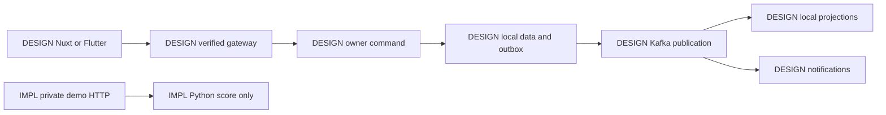
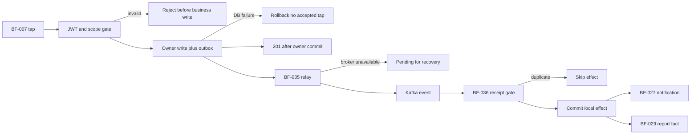
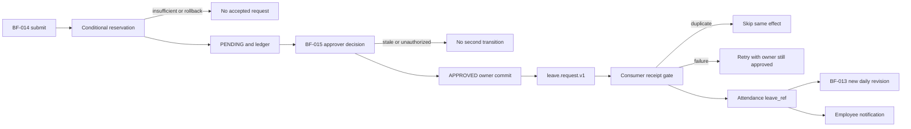
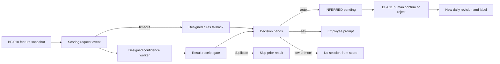

# HRFlow business-flow reference

## I Overview

[IMPL] This is a source-first snapshot of checkpoint 7141114 on 2026-10-23, not a release claim. The [inventory](docs/business-flow/_inventory.md) was completed before workflow drafting. Seven Java services have startup/security configuration but no business controller, migration, publisher, listener or job. The Python scoring prototype has three application handlers plus four generated documentation route objects. (inventory source searches; ml/confidence-service/confidence/api.py#app)

[INFERRED] Workflow bodies are grouped into bounded domain files so the primary reference retains all ten requested parts and remains readable under the existing portable-document size convention. Use the catalogue below, then its body, API map, data map and QA IDs; all links are ordinary relative Markdown without heading anchors. (docs/roadmap/FORMAT-GUIDE.md — Heading hierarchy/links; [domain inventory](docs/business-flow/_inventory.md))

[DESIGN] HRFlow intends organization/attendance/leave/requests/approvals/notifications/reporting for tenant companies, with Nuxt/Flutter clients, seven Java services, Kafka/Avro/Registry, PostgreSQL owner schemas and a Python confidence worker. AWS/Kubernetes remain future design; no cloud execution is inferred. (docs/Architecture.md; docs/adr/008-FINAL-SERVICE-AND-CLOUD-DESIGN.md)

### Evidence and status semantics

| Label | Meaning and authority |
| --- | --- |
| [IMPL] | Confirmed source/config or an explicitly recorded read-only observation; does not mean deployed |
| [TEST] | A source test confirms the statement; execution is separately reported |
| [DESIGN] | Documented target only; approved architecture/ADRs qualified separately from historical references |
| [INFERRED] | Reasoning from cited facts; not adopted behavior or policy |
| [UNKNOWN] | Missing code, contract, policy or evidence is identified |

[INFERRED] For current behavior, source/migrations outrank tests, then designs, then inference. For desired behavior, current approved documents/ADR supersession qualify historical material. A design route/table/event never becomes IMPL because its name is documented. IMPLEMENTED means the scoped standalone workflow exists; PARTIAL lists missing pieces; DESIGNED-ONLY has no business implementation; NOT FOUND would mean no source/design trace was found. (task evidence hierarchy; inventory; docs/adr/README.md)

| Actor / concept | Meaning and current boundary |
| --- | --- |
| Employee | [DESIGN] Self-scope HR operations; no Java role/resource policy yet (architecture part01 §8.4; inventory) |
| Manager | [DESIGN] Current direct-report scope and approval decisions; relationship enforcement absent (part01 §8.4) |
| HR_ADMIN / OWNER | [DESIGN] Tenant-wide HR/organization scope; not a cross-tenant admin bypass (part01 §8.3–8.4) |
| Operator / worker | [DESIGN] Private deploy/replay/background duties with trusted tenant context; no consumer implementation (ADR 008) |
| Session / evidence / daily status | [DESIGN] Worked interval, immutable observation and derived employee-day revision are separate (part02 §11.2) |
| Ledger / balance | [DESIGN] Append accounting entries versus rebuildable cached entitlement arithmetic (part02 §12.2) |
| Outbox / inbox | [DESIGN] Owner publication intent versus handler receipt/effect guard; no running relay/handler (part02 §10.6–10.7; inventory) |
| Read model / eventual consistency | [DESIGN] Owner-local event-derived copy; another service may lag a committed command (part03 §15/17.4) |

[DESIGN] References to part01/02/03 below mean the approved INCOMING-ARCHITECTURE-V2 parts in docs/reference, not the older ARCHITECTURE-REFERENCE archive. Canonical links: [part01](docs/reference/INCOMING-ARCHITECTURE-V2-01.md), [part02](docs/reference/INCOMING-ARCHITECTURE-V2-02.md), [part03](docs/reference/INCOMING-ARCHITECTURE-V2-03.md), [current API/data rules](docs/REST-API-DATABASE-DESIGN.md), [ADR 004 proposed policy](docs/adr/004-ATTENDANCE-AND-LEAVE-CONFLICTS.md), [ADR 008](docs/adr/008-FINAL-SERVICE-AND-CLOUD-DESIGN.md).

[DESIGN] The following target process map has no implemented Java HR path; the demo scoring arrow is a separate actual entry point. (part01 §4/8; part02 §9; part03 §16.5; inventory)

Text version:

- [DESIGN] Client commands pass the trusted gateway, owner-local write/outbox, broker and independent consumers. (part02 §9/10)
- [IMPL] The private Python score handler returns a decision only; it does not execute that target HR chain. (ml/confidence-service/confidence/api.py#score)

## II Rules and states

### Intended invariant verification

| Intended invariant | Result in current code | Evidence and qualification |
| --- | --- |
| 1 No business service HTTP | not yet implemented | [IMPL] No Java client calls/handlers/listeners; absence is not proof of a running integration. [DESIGN] Reporting recovery has an explicit admin re-export exception (inventory; part03 §15.4; ADR 008) |
| 2 Every table/query tenant-scoped | not yet implemented | [IMPL] No business tables/repository queries. [DESIGN] Metadata-only worker discovery is an explicit exception, never an unscoped personal-data grant (infra/docker/postgres-init.sql; inventory; ADR 008 tenant discovery) |
| 3 Strip and derive identity headers from JWT | not yet implemented | [IMPL] Gateway routes empty and security deny-only; no JWT/filter/header rewrite (services/api-gateway/src/main/resources/application.yaml; config/SecurityConfiguration.java) |
| 4 Owner write/outbox and consumer receipt/effect | not yet implemented | [IMPL] No transactions, outbox/inbox tables or handlers. [DESIGN] Receipt key sketches differ (inventory; current API/data outbox section; part02 §10.6–10.7) |
| 5 tenantId:employeeId for every partition | not yet implemented | [IMPL] No producer key. [DESIGN] Shift/date/request keys deliberately differ, so literal universal wording is inaccurate (part02 §10.1) |
| 6 Append-only/manual/precedence | not yet implemented | [IMPL] No attendance persistence. [DESIGN] Approved precedence includes TAP; manual versus leave overlay remains proposed policy conflict (part02 §11.2–11.4; ADR 004) |
| 7 Late after shift start + grace10 | not yet implemented | [DESIGN] Strict greater-than, equality is not late; no calculator exists (part02 §11.5; inventory) |
| 8 Conditional leave update + ledger | not yet implemented | [DESIGN] Conditional UPDATE required in part02 §12.4; roadmap also describes pessimistic locking. [IMPL] Neither is coded (inventory) |
| 9 Consumer failure cannot fail prior HTTP response | not yet implemented | [DESIGN] Async owner commit boundary; no consumer or HR handler implements it (part02 §11.7; inventory) |
| 10 ML bands/mock blocking | holds in scoped prototype | [IMPL] Raw p compared against loaded thresholds; current auto0.80/ask0.50, missing-model auto0.90; mock raw0 yields NO_ACTION with current valid metadata. No attendance created (ml/confidence-service/confidence/model.py#ConfidenceModel.score; ml/confidence-service/models/meta.json) |

[INFERRED] Result: one scoped holds, zero verified code violations of these ten statements, nine not-yet-implemented. Design wording conflicts are listed separately instead of classifying absent business code as a passing guarantee. Threshold metadata is not validated, so the ML conclusion is scoped to the current valid configuration. (inventory; ml/confidence-service/confidence/model.py#ConfidenceModel.score)

### Lifecycles and calculations

| Entity/rule | Allowed or described behavior | Implementation boundary |
| --- | --- | --- |
| Session | [DESIGN] None → OPEN → CLOSED; source immutable; rejected inference excluded | No session table/handler (part02 §11.2–11.3; inventory) |
| Inference | [DESIGN] INFERRED/PENDING → CONFIRMED or REJECTED; keep history | No confirmation consumer/controller (part02 §11.3) |
| Calendar precedence | [DESIGN] Holiday > Approved leave > Manual > Tap > non-rejected Inferred > Absent; DAY_OFF short-circuit wording | Proposed ADR 004 separates evidence/calendar/review; overlap policy not settled (part02 §11.4–11.5; ADR 004) |
| Daily status | [DESIGN] Derived provisional → finalized revision → newer recomputation after late evidence | No version guard/recompute code (part02 §11.6/11.11) |
| Late/early/worked | [DESIGN] first_in > start + grace; early if last_out < end - tolerance; worked = sum durations | Default grace10; open-interval rounding/break/tolerance details unresolved (part02 §11.5) |
| Leave | [DESIGN] New → PENDING → APPROVED/REJECTED; pending or eligible approved future cancellation → CANCELLED | Diagram misplaces a pending-cancel arrow below REJECTED; do not infer that transition (part02 §12.1) |
| Balance | [DESIGN] available = entitled + carried_over - used - pending; submit reserves, approve pending→used, reject releases, cancel compensates | Exact numeric ledger intended; no writes (part02 §12.2–12.4) |
| Request | [DESIGN] DRAFT → PENDING → APPROVED → FULFILLED for materials; reject → REJECTED; draft/pending cancel → CANCELLED | No state machine or stock reservation (part03 §13) |
| Tenant/ownership | [DESIGN] Verified token tenant, local owner schema, scoped predicates and personal-data RLS; schema separation alone insufficient | Python accepts caller IDs; Java business queries absent (current API/data tenant rules; ml/confidence-service/confidence/api.py#Evidence) |

### Implemented ML input and decision details

| Input / calculation | Source behavior | Evidence |
| --- | --- | --- |
| tenantId, employeeId, workDate | [IMPL] Required plain strings; no nonempty/UUID/date or authentication constraint | ml/confidence-service/confidence/api.py#Evidence; ml/confidence-service/confidence/api.py#score |
| in_geofence, wifi_connected, is_usual_device, mock_location_flag | [IMPL] Required integer flags0–1 | ml/confidence-service/confidence/api.py#Evidence |
| gps_accuracy_m, minutes_in_zone, arrival_deviation_min | [IMPL] Required floats >=0 | ml/confidence-service/confidence/api.py#Evidence |
| ble_beacons_seen, movement_events, interaction_events | [IMPL] Required integer counts >=0 | ml/confidence-service/confidence/api.py#Evidence |
| minutes_after_shift_start | [IMPL] Required float, negative allowed for early arrival | ml/confidence-service/confidence/api.py#Evidence |
| present_days_last_14 | [IMPL] Required integer0–14 | ml/confidence-service/confidence/api.py#Evidence |
| Rules fallback | [IMPL] .30 geofence + .15 Wi-Fi + .15 min(BLE,3)/3 + .15 min(movement,20)/20 + .10 min(interaction,10)/10 + .05 usual-device + .10 min(history,10)/10; cap1 and round4 | ml/confidence-service/confidence/rules.py#rules_score |
| Fallback ignored features | [IMPL] Accuracy, minutes-in-zone, minutes-after-start and arrival deviation do not enter that formula | ml/confidence-service/confidence/rules.py#rules_score; ml/confidence-service/confidence/features.py#FEATURES |
| API anti-mock | [IMPL] Model wrapper sets0 before band selection; direct rules helper returns.05 but is bypassed on that API path | ml/confidence-service/confidence/model.py#ConfidenceModel.score; ml/confidence-service/confidence/rules.py#rules_score |
| Threshold/rounding | [IMPL] Active shipped metadata auto.80/ask.50; raw comparison precedes returned round4. Fallback defaults auto.90/ask.50 | ml/confidence-service/confidence/model.py#ConfidenceModel.__init__; ml/confidence-service/confidence/model.py#ConfidenceModel.score; ml/confidence-service/models/meta.json |
| Explanations | [IMPL] Loaded model returns up to three occlusion effects; rules fallback has none and mock branch one | ml/confidence-service/confidence/model.py#ConfidenceModel._explain; ml/confidence-service/confidence/model.py#ConfidenceModel.score |

## III Workflow catalogue

[IMPL] Statuses below derive from source discovery, not the amount of design text. Implemented workflows are scoped local Python behavior; no Java business flow is executable. [DESIGN] All forty bodies use the requested field template, with UNKNOWN/N/A where evidence is absent. (inventory; linked bodies)

| ID | Business operation | Status | Workflow body |
| --- | --- | --- | --- |
| BF-001 | Login | DESIGNED-ONLY | [identity](docs/business-flow/IDENTITY.md) |
| BF-002 | Refresh token rotation | DESIGNED-ONLY | [identity](docs/business-flow/IDENTITY.md) |
| BF-003 | Tenant onboarding | DESIGNED-ONLY | [identity](docs/business-flow/IDENTITY.md) |
| BF-004 | Employee and organization onboarding | DESIGNED-ONLY | [identity](docs/business-flow/IDENTITY.md) |
| BF-005 | Shift definition and assignment | DESIGNED-ONLY | [identity](docs/business-flow/IDENTITY.md) |
| BF-006 | Holiday management | DESIGNED-ONLY | [identity](docs/business-flow/IDENTITY.md) |
| BF-007 | One-tap check-in | DESIGNED-ONLY | [attendance](docs/business-flow/ATTENDANCE.md) |
| BF-008 | Check-out | DESIGNED-ONLY | [attendance](docs/business-flow/ATTENDANCE.md) |
| BF-009 | Evidence ingestion | DESIGNED-ONLY | [attendance](docs/business-flow/ATTENDANCE.md) |
| BF-010 | Inference orchestration | DESIGNED-ONLY | [attendance](docs/business-flow/ATTENDANCE.md) |
| BF-011 | Next-day confirmation or rejection | DESIGNED-ONLY | [attendance](docs/business-flow/ATTENDANCE.md) |
| BF-012 | Attendance correction/manual entry | DESIGNED-ONLY | [attendance](docs/business-flow/ATTENDANCE.md) |
| BF-013 | Daily-status finalization | DESIGNED-ONLY | [attendance](docs/business-flow/ATTENDANCE.md) |
| BF-014 | Leave submission/reservation | DESIGNED-ONLY | [leave](docs/business-flow/LEAVE.md) |
| BF-015 | Leave approval | DESIGNED-ONLY | [leave](docs/business-flow/LEAVE.md) |
| BF-016 | Leave rejection | DESIGNED-ONLY | [leave](docs/business-flow/LEAVE.md) |
| BF-017 | Leave cancellation | DESIGNED-ONLY | [leave](docs/business-flow/LEAVE.md) |
| BF-018 | Leave balance query and HR adjustment | DESIGNED-ONLY | [leave](docs/business-flow/LEAVE.md) |
| BF-019 | Year-end rollover | DESIGNED-ONLY | [leave](docs/business-flow/LEAVE.md) |
| BF-020 | Leave-versus-attendance conflict review | DESIGNED-ONLY | [leave](docs/business-flow/LEAVE.md) |
| BF-021 | Create/edit general or material request | DESIGNED-ONLY | [request](docs/business-flow/REQUEST.md) |
| BF-022 | Submit request and resolve approval chain | DESIGNED-ONLY | [request](docs/business-flow/REQUEST.md) |
| BF-023 | Approve request step | DESIGNED-ONLY | [request](docs/business-flow/REQUEST.md) |
| BF-024 | Reject or cancel request | DESIGNED-ONLY | [request](docs/business-flow/REQUEST.md) |
| BF-025 | Material fulfillment | DESIGNED-ONLY | [request](docs/business-flow/REQUEST.md) |
| BF-026 | Private attachment upload/download | DESIGNED-ONLY | [request](docs/business-flow/REQUEST.md) |
| BF-027 | Notification delivery | DESIGNED-ONLY | [notification](docs/business-flow/NOTIFICATION.md) |
| BF-028 | Notification preferences and inbox reads | DESIGNED-ONLY | [notification](docs/business-flow/NOTIFICATION.md) |
| BF-029 | Projection updates and report queries | DESIGNED-ONLY | [reporting](docs/business-flow/REPORTING.md) |
| BF-030 | Report export | DESIGNED-ONLY | [reporting](docs/business-flow/REPORTING.md) |
| BF-031 | Reporting full rebuild beyond retention | DESIGNED-ONLY | [reporting](docs/business-flow/REPORTING.md) |
| BF-032 | Standalone confidence scoring | IMPLEMENTED | [ml](docs/business-flow/ML.md) |
| BF-033 | Model health and metadata inspection | IMPLEMENTED | [ml](docs/business-flow/ML.md) |
| BF-034 | Synthetic data and model training | IMPLEMENTED | [ml](docs/business-flow/ML.md) |
| BF-035 | Owner outbox relay | DESIGNED-ONLY | [infrastructure](docs/business-flow/INFRASTRUCTURE.md) |
| BF-036 | Inbox consumption, retry and dead letter | DESIGNED-ONLY | [infrastructure](docs/business-flow/INFRASTRUCTURE.md) |
| BF-037 | Shift cutoff scheduling | DESIGNED-ONLY | [infrastructure](docs/business-flow/INFRASTRUCTURE.md) |
| BF-038 | Local reference read-model bootstrap | DESIGNED-ONLY | [infrastructure](docs/business-flow/INFRASTRUCTURE.md) |
| BF-039 | Technical probes and API documentation | PARTIAL | [infrastructure](docs/business-flow/INFRASTRUCTURE.md) |
| BF-040 | Logout and token-family revocation | DESIGNED-ONLY | [identity](docs/business-flow/IDENTITY.md) |

[IMPL] Catalogue totals: IMPLEMENTED3, PARTIAL1, DESIGNED-ONLY36, NOT FOUND0. PARTIAL BF-039 has technical routes/configuration but lacks replay-aware business readiness. Every seeded operation had at least a design reference; that is not implementation. (inventory; bodies BF-001–040)

## IV End-to-end journeys

[DESIGN] All three journey diagrams are target flows only. Arrows name required local boundaries and downstream effects; no diagram asserts a running Java transaction, event relay or tenant guarantee. The actual Python debug endpoint is intentionally not substituted for the designed Kafka worker. (part02 §10/11/12; part03 §16.5; inventory)

### Check-in to notification and report

Text version:

- [DESIGN] Validate identity before the owner transaction; local failure rolls it back, success returns201 before broker/consumer effects. (part02 §11.7; current API/data outbox rules)
- [DESIGN] Broker outage leaves committed intent pending; inbox skips duplicates and each downstream owner commits separately. Consumer failure delays effects, never rewinds the already completed owner response. (part02 §10.6–10.8; ADR 008)

### Leave submission to attendance overlay

Text version:

- [DESIGN] Reserve and ledger locally; failed reservation/transaction does not accept the request. Approval checks current scope/revision and moves pending to used once. (part02 §12.1–12.4)
- [DESIGN] Owner approval precedes asynchronous attendance projection; duplicates skip and consumer failures retain approval while recovery runs. Overlap review is proposed ADR004, not a silent refund. (part02 §12.5; ADR 004)

### Forgotten tap to pending inference and confirmation

Text version:

- [DESIGN] Kafka feature/result flow, timeout fallback and result dedup precede inference decisions; actual HTTP /score only returns a score and has no such worker. (part02 §11.9; part03 §16.5; ml/confidence-service/confidence/api.py#score)
- [DESIGN] Auto creates pending inference; ask prompts; low/mock creates none. Human rejection excludes inference from effective status while preserving evidence and publishing labels. (part02 §11.3/11.9; part03 §16.4–16.5)

## V API to workflow map

[IMPL] Seven of seven discovered Python route objects map to a workflow/technical category: E01/E02→BF-033, E03→BF-032 and E04–E07→BF-039. There are zero Java production business controller mappings or gateway forwarding routes. Twenty-one configured Java management health surfaces are separately mapped as technical; test-only ProbeController routes are excluded from the denominator. (inventory; ml/confidence-service/confidence/api.py#app; services/api-gateway/src/main/resources/application.yaml)

[DESIGN] The [complete API map](docs/business-flow/API-MAP.md) separately crosswalks all112 historical candidate method/path pairs to workflow context. It preserves method, route, reference and non-live status; the actual route table additionally gives handler/auth/validation. Active domain OpenAPI is absent, so historical paths/roles/schemas cannot be treated as installed endpoints or approved new scope. (docs/REST-API-DATABASE-DESIGN.md — Wire conventions/Historical references; inventory)

## VI Events

[IMPL] The [event/data reference](docs/business-flow/EVENTS-DATA.md) lists every one of the ten scripted topics, the single existing Avro record, all proposed scoring/optional/retry/DLQ patterns, and the absence of publishers/listeners/jobs. Producers/consumers and keys are explicitly DESIGN; no topic was created or broker inspected during this task. (infra/scripts/create-topic.sh; libs/hrflow-contracts/events/attendance-checked-in.v1.avsc#AttendanceCheckedIn; inventory)

[DESIGN] Domain keys vary by aggregate; schema/name alone does not prove routing. Transport duplicates remain possible across publication acknowledgment boundaries, and external notification-send recovery is unspecified. No measured eventual-consistency maximum is available. (part02 §10.1–10.8; part03 §14/15.2; ADR 008)

## VII Data map

[IMPL] No business table exists as a source migration. The [data map](docs/business-flow/EVENTS-DATA.md) records proposed owner tables, conflicting singular/plural naming, constraints, transaction/retention limits and the Python file effects. Six CREATE SCHEMA statements establish neither tables nor tenant isolation. (infra/docker/postgres-init.sql; inventory)

[DESIGN] One owner writes authoritative data; copies consume events. Personal data needs scoped predicates plus RLS/non-owner roles. Metadata-only background discovery is the documented narrow exception. Soft-delete/retention targets are not implemented purge guarantees. (current API/data tenant rules; ADR 008; part03 §17)

## VIII QA

[DESIGN] [QA catalogue](docs/business-flow/QA.md) contains QA-001–100, each linked to workflow IDs with preconditions/data, steps, expected result/state and from-requirement or recommended-by-risk origin. It covers positive, negative, boundaries, permissions, state races, duplicate events, rollback and tenant isolation. Most cases are not executable because the business workflows do not exist. (QA catalogue; workflow source/design citations)

[TEST] Existing Python suite executed safely: twelve tests passed with one existing Starlette/httpx warning. No server or external service was started. Java test sources were read, not rerun, and training/integration/deployment/restore were not run. The [verification record](docs/business-flow/VERIFICATION.md) separates those results from the one hundred planned acceptance scenarios. (ml/confidence-service/tests/test_service.py; tests/test_launcher.py)

## IX Traceability tables

### Workflow to boundary and QA

[DESIGN] Entries below abbreviate owner/event/data context; exact names/status/citations and failure boundaries are in each workflow body. All Java entries are designed-only except technical BF-039. (catalogue and source inventory)

| Workflows | Entry / owner | Data or integration context | QA IDs |
| --- | --- | --- | --- |
| BF-001 | identity command/event design | identity_org; org.* where specified | QA-001, QA-002 |
| BF-002 | identity command/event design | identity_org; org.* where specified | QA-003, QA-004 |
| BF-003 | identity command/event design | identity_org; org.* where specified | QA-005, QA-006 |
| BF-004 | identity command/event design | identity_org; org.* where specified | QA-007, QA-008 |
| BF-005 | identity command/event design | identity_org; org.* where specified | QA-009, QA-010 |
| BF-006 | identity command/event design | identity_org; org.* where specified | QA-011, QA-012 |
| BF-007 | attendance command/event design | attendance; session/daily/evidence facts | QA-013, QA-014 |
| BF-008 | attendance command/event design | attendance; session/daily/evidence facts | QA-015, QA-016 |
| BF-009 | attendance command/event design | attendance; session/daily/evidence facts | QA-017, QA-018 |
| BF-010 | attendance command/event design | attendance; session/daily/evidence facts | QA-019, QA-020 |
| BF-011 | attendance command/event design | attendance; session/daily/evidence facts | QA-021, QA-022 |
| BF-012 | attendance command/event design | attendance; session/daily/evidence facts | QA-023, QA-024 |
| BF-013 | attendance command/event design | attendance; session/daily/evidence facts | QA-025, QA-026 |
| BF-014 | leave command/event design | leave; request/balance/ledger | QA-027, QA-028 |
| BF-015 | leave command/event design | leave; request/balance/ledger | QA-029, QA-030 |
| BF-016 | leave command/event design | leave; request/balance/ledger | QA-031, QA-032 |
| BF-017 | leave command/event design | leave; request/balance/ledger | QA-033, QA-034 |
| BF-018 | leave command/event design | leave; request/balance/ledger | QA-035, QA-036 |
| BF-019 | leave command/event design | leave; request/balance/ledger | QA-037, QA-038 |
| BF-020 | leave command/event design | leave; request/balance/ledger | QA-039, QA-040 |
| BF-021 | request command/event design | request; header/steps/private files | QA-041, QA-042 |
| BF-022 | request command/event design | request; header/steps/private files | QA-043, QA-044 |
| BF-023 | request command/event design | request; header/steps/private files | QA-045, QA-046 |
| BF-024 | request command/event design | request; header/steps/private files | QA-047, QA-048 |
| BF-025 | request command/event design | request; header/steps/private files | QA-049, QA-050 |
| BF-026 | request command/event design | request; header/steps/private files | QA-051, QA-052 |
| BF-027 | notification command/event design | notification; inbox/preferences/channels | QA-053, QA-054 |
| BF-028 | notification command/event design | notification; inbox/preferences/channels | QA-055, QA-056 |
| BF-029 | reporting command/event design | reporting; facts/export/rebuild | QA-057, QA-058 |
| BF-030 | reporting command/event design | reporting; facts/export/rebuild | QA-059, QA-060 |
| BF-031 | reporting command/event design | reporting; facts/export/rebuild | QA-061, QA-062 |
| BF-032 | POST /score | No DB/event effects; process model | QA-063, QA-064 |
| BF-033 | GET /health, /model | No DB/event effects; process model | QA-065, QA-066 |
| BF-034 | Local training CLI | CSV → joblib/meta pair | QA-067, QA-068 |
| BF-035 | infrastructure command/event design | Owner outbox/inbox/reference/time events | QA-069, QA-070 |
| BF-036 | infrastructure command/event design | Owner outbox/inbox/reference/time events | QA-071, QA-072 |
| BF-037 | infrastructure command/event design | Owner outbox/inbox/reference/time events | QA-073, QA-074 |
| BF-038 | infrastructure command/event design | Owner outbox/inbox/reference/time events | QA-075, QA-076 |
| BF-039 | Technical health/docs | N/A business writes | QA-077, QA-078 |
| BF-040 | identity command/event design | identity_org; org.* where specified | QA-079, QA-080 |

### Business rule to enforcement and issue

| Rule / issue | Workflow | Enforcement or missing evidence |
| --- | --- | --- |
| Tenant/self/team scope | BF-001/004/007/014/021/028/029 | [DESIGN] part01 §8.4; [IMPL] no business scope query or Python trusted identity (ml/confidence-service/confidence/api.py#Evidence; inventory) |
| Grace equality/late and summed duration | BF-008/013 | [DESIGN] part02 §11.5 only; no calculator (inventory) |
| Conditional balance plus ledger | BF-014–020 | [DESIGN] part02 §12.2–12.4; no SQL/ledger (inventory); discrepancy C02 |
| First approval wins | BF-023/024 | [DESIGN] part03 §13.3; no lock/version guard (inventory) |
| ML bands and raw-rounding boundary | BF-032 | [IMPL] ml/confidence-service/confidence/model.py#ConfidenceModel.score; metadata .80/.50, missing-artifact default .90/.50 |
| No provider duplicate guarantee | BF-027/036 | [INFERRED] external-send versus local-receipt crash boundary unresolved; facts part03 §14 + no delivery source |
| Owner commit / broker ack / consumer offset order | BF-035/036 | [DESIGN] ADR 008/current API only; no transaction or listener (inventory) |
| Broken SQL bind/Registry listener | BF-003/035/036/038 | [IMPL] defects V01/V02 below; startup blocked independently of business code |
| Prototype identity/input/model failure | BF-032–034 | [IMPL] ml/confidence-service/confidence/api.py#Evidence; ml/confidence-service/confidence/model.py#ConfidenceModel.__init__; risks R01–R03 below |

## X Findings

### Verified defects and limitations by impact

| ID | Impact / finding | Workflows | Evidence |
| --- | --- | --- | --- |
| V01 | [IMPL] Compose PostgreSQL init bind resolves to nonexistent infra/docker/infra/docker/postgres-init.sql rather than the existing init file | BF-003/038 | infra/docker/docker-compose.yaml:12 relative bind source; infra/docker/postgres-init.sql exists; path resolution read-only check |
| V02 | [IMPL] Registry bootstrap points at kafka:19092 while declared internal listener is29092; no19092 listener exists | BF-035/036/038 | infra/docker/docker-compose.yaml:25–26/52 selected listener properties |
| V03 | [IMPL] Python accepts untrusted string tenant/employee/date and echoes them without authentication; this is a verified prototype limitation, not proof of a deployed breach | BF-032/033 | ml/confidence-service/confidence/api.py#Evidence; ml/confidence-service/confidence/api.py#score; ml/confidence-service/run.py#server_options loopback default |
| V04 | [IMPL] Missing artifact pair uses rules, but corrupt/incompatible artifacts have no recovery catch; startup can propagate load errors | BF-033/034 | ml/confidence-service/confidence/model.py#ConfidenceModel.__init__; api.py module model construction |

### Suspected business risks

| ID | Risk and factual basis | Workflows | Required proof |
| --- | --- | --- | --- |
| R01 | [INFERRED] Publicly exposing the unauthed scoring prototype could accept forged attribution; no auth dependency and caller IDs are facts | BF-032 | Trusted boundary/identity tests before integration (ml/confidence-service/confidence/api.py#Evidence; ml/confidence-service/confidence/api.py#score; part03 §16.5) |
| R02 | [INFERRED] Same test split selects threshold and reports auto_precision, so real-world precision/consent is not established | BF-034 | Independent policy evaluation and provenance review (ml/confidence-service/training/train.py#main; ml/confidence-service/models/meta.json) |
| R03 | [INFERRED] Sequential joblib/meta writes can expose a mismatched pair during interruption/concurrent deploy; no swap/lock exists | BF-033/034 | Artifact publication/recovery test and rollout policy (ml/confidence-service/training/train.py#main; ml/confidence-service/confidence/model.py#ConfidenceModel.__init__) |
| R04 | [INFERRED] Unique delivery row cannot alone prevent duplicate external push/email after crash; provider transaction is outside local DB | BF-027 | Provider/replay crash proof; no sender source exists (part03 §14; inventory) |
| R05 | [INFERRED] Schema separation/configured readiness may be mistaken for tenant/replay enforcement; current code has no RLS, business query or catch-up guard | BF-003/038/039 | Non-owner pool/absence-context/replay gates (application.yaml; inventory; ADR 008) |

### Code versus documents and design discrepancies

| ID | Discrepancy | Current behavior / unresolved target |
| --- | --- | --- |
| C01 | [DESIGN] Many historical APIs versus no Java business routes | [IMPL] Current gateway is empty/deny-only; unavailable features are expected gaps, not automatically code defects (inventory; API map) |
| C02 | [DESIGN] Conditional leave UPDATE versus roadmap/handbook pessimistic locking | [UNKNOWN] Neither implemented; choose and verify one strategy before balance code (part02 §12.4; docs/PLAN.md Week06; inventory) |
| C03 | [DESIGN] Manual-always-wins wording versus holiday/leave overlay and proposed conflict review | [UNKNOWN] ADR004 remains Proposed; no HR approval or effective policy engine (part02 §11.4; ADR004; ADR index) |
| C04 | [DESIGN] Universal employee event key versus shift/date/request exceptions | [IMPL] No producer key exists; per-topic design differs intentionally (part02 §10.1; inventory) |
| C05 | [DESIGN] bytea outbox/inbox sketch versus JSONB outbox_events and tenant-scoped handler receipts | [UNKNOWN] No migration chooses physical shape; do not merge names as installed tables (part02 §10.6–10.7; current API/data) |
| C06 | [DESIGN] Full envelope/TAP source versus the sole smaller Avro record | [IMPL] Existing record lacks correlation/causation/type/aggregate fields and TAP; no producer binds it to session topic (Avro record; part02 §10.3/11.7) |
| C07 | [DESIGN] Top-three explanations for every score | [IMPL] Rules fallback returns no reasons; mock path returns one, model path up to three (part03 §16.6; ml/confidence-service/confidence/model.py#ConfidenceModel.score; ml/confidence-service/confidence/model.py#ConfidenceModel._explain) |
| C08 | [DESIGN] Cold-start grace versus all model-unavailable conditions | [IMPL] Only missing pair triggers fallback; load exceptions are not caught (part03 §16.7; ml/confidence-service/confidence/model.py#ConfidenceModel.__init__) |
| C09 | [DESIGN] Generic old error409/merged OpenAPI versus current RFC9457/412/428/single contract | [UNKNOWN] No active OpenAPI or business error handler resolves wire details; current API/data rules are newer design (part03 §18.2; current API/data) |
| C10 | [DESIGN] Event-only integration versus reporting full-history rebuild exception | [UNKNOWN] Recovery snapshot/admin transport is not implemented; no ordinary business HTTP inferred (part03 §15.4; ADR008) |
| C11 | [DESIGN] Pending leave cancel arrow visually follows REJECTED | [UNKNOWN] Written pending/future cancel intent differs; active state contract needed (part02 §12.1) |
| C12 | [DESIGN] Target replay-aware readiness versus configured readinessState/db only | [IMPL] No lag/reference gate; do not accept liveness as HR readiness (part02 §10.9; attendance application.yaml) |

### Owner questions and completion boundary

[UNKNOWN] The owner must settle HR conflict precedence/independent approvals; overnight/DST/open-session durations; cross-year pending leave and carry caps; effective request/stock fulfillment rules; private-file/label retention and consent; model artifact publication/independent validation; full-history rebuild snapshots; exact retry/DLQ/replay contract; and active API/event/table naming before those behaviors can be implemented. The cited workflows identify each missing decision rather than inventing it. (ADR004; part02 §11/12; part03 §13–17; current API/data; inventory)

[IMPL] All thirteen inventoried module/client/library/infrastructure roots were inspected; all seven observed route objects were mapped and all ten scripted topics/one Avro record were accounted for. No module was skipped; end-to-end HR execution cannot be traced through code that does not exist. [UNKNOWN] Historical administrative candidates remain design context until active contracts/policies adopt them. ([inventory](docs/business-flow/_inventory.md); [verification](docs/business-flow/VERIFICATION.md); [API map](docs/business-flow/API-MAP.md))
