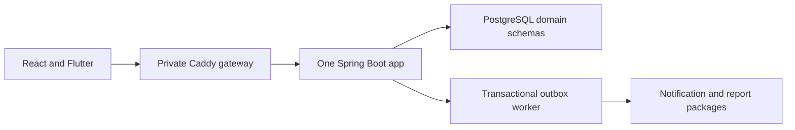

# HRFlow architecture

## Current decision and implementation status

The 2026-10-23 finish-line request supersedes the seven-service production plan. Outcome C is selected: one Java 21 Spring Boot application, domain packages, PostgreSQL 16 schemas, a local transactional outbox, and Caddy as gateway. React is the required web target; Flutter starts with an OpenAPI-generated mock in Week 1. This is a settled design for the guide, not an implemented app.

Source evidence remains seven application entry points in `services`, Nuxt in `web/package.json`, and standalone confidence scoring in `ml`. No business migrations/controllers/outbox/auth or production deployment is verified. Code is unchanged by this documentation task.

## Logical boundaries and physical runtime

Text version:

- Clients call Caddy, which routes to one application.
- Packages preserve identity-org, attendance, leave, request, notification and reporting ownership.
- Domain writes commit outbox intent locally; worker handlers commit inbox plus effect before acknowledging local completion.
- No Kafka or service-to-service HTTP is needed for this deployment. External provider I/O remains separate and retryable.

## Data and security

Schemas remain `identity_org`, `attendance`, `leave`, `request`, `notification`, and `reporting`. Packages access only owner repositories; no cross-package SQL joins or foreign keys. Public module APIs or revised projections supply dependencies. Physical co-location does not make arbitrary shared tables acceptable.

Trusted tenant comes only from verified JWT, not body/path/header selection. Authentication verifies identity; authorization verifies current role/resource scope; tenant isolation verifies company boundary. All are required. Composite tenant constraints, scoped lists/counts/files/exports/jobs and two-tenant tests remain mandatory.

Short access JWT plus hashed rotating refresh families remain the auth baseline. First provisioning uses a protected operator procedure. Explicit login tenant slug locates credentials before a token exists; it is not permission to access tenant business data. Platform provisioning uses separate authority. No externally routable API exists before HTTPS, auth, firewall, secrets and a verified backup.

## Domain invariants

Raw evidence is append-only in normal flow; checkout updates session projection, corrections append a replacement interpretation/action. Work date is shift-local; MVP supports one same-day shift and rejects unsupported overnight input. Manual approved interpretation supersedes inference without deleting holiday/leave meaning. Conflict goes to explicit HR review.

Leave reserves pending balance under deterministic employee/balance locks. Approval transfers pending to used, cancellation compensates once. NEEDS_REVIEW retains debit until HR keeps or cancels leave. General requests use assigned independent approvers, bounded forms, advisory material stock and private attachments. Audit, notifications and CSV remain Must features.

The outbox is still required. Its local dispatcher tracks each required handler receipt; a crash cannot turn a missing handler effect into completion. Duplicate and older snapshots are handled by tenant/event/handler inbox plus aggregate revision. External sends can duplicate after uncertain timeout, so in-app records and delivery attempts are distinct. There is no Kafka offset/Registry/exactly-once claim under outcome C.

## Deployment and restore

Existing computer, Docker Compose, PostgreSQL, application, Caddy and private Uptime Kuma only. Cloudflare Tunnel is the chosen access path because WAN/router capability is unknown; public TLS is automatic at Cloudflare, Caddy is private origin. No paid cloud infrastructure is required. Domain, external disk, power and ISP cost remain real; free Tunnel is not a hosting SLA.

Nightly custom pg_dump, 14-day retention, verified external-disk copy and weekly scratch restore begin Week 2. Clean-machine restore is repeated Weeks 10 and 12. PostgreSQL dumps do not include attachments/secrets automatically: copy private files and protected recovery key references separately. One machine is not high availability; macOS Docker login/awake requirements are tested, never assumed away.

## Delivery and capacity

Five stones per week, normally 15 steps and 17 in Week 2; Thursday buffer and Friday real-host redeploy/restore. User hours are interpreted as 24 each, with 70 percent planned and 15 percent lighter Weeks 4/8. [Baseline math](roadmap/00-PREPARATION/PROJECT-BASELINE.md) is conditional, not a guarantee.

## Canonical references

- [Finish-line decisions](roadmap/DECISION-REGISTER.md).
- [Migration plan](roadmap/00-PREPARATION/MIGRATION-PLAN.md).
- [Current API and database mapping](REST-API-DATABASE-DESIGN.md).
- [Execution plan](PLAN.md).
- [Superseding ADR](adr/006-FINISH-LINE-MODULAR-MONOLITH.md).
- [Historical architecture index](reference/README.md).

Historical reference parts preserve the previous detailed domain/operational material. Their seven-service/Kafka/cloud assumptions are superseded and cannot override this current specification.

## Second-pass engineering clarification

[ADR 007](adr/007-QUALITY-AND-TENANT-DEFENSE.md) refines tenant defense and local event ownership without changing outcome C. [Architecture review](roadmap/ARCHITECTURE-REVIEW-V2.md) records evidence and every ADR verdict. Incoming contradictory text is preserved in the [reference index](reference/README.md).

Use scoped JPA/JDBC owner repositories as the existing dependency baseline permits; no new JDBC-only or reactive-gateway requirement is inferred from scaffold accidents. Personal-data tables gain tested PostgreSQL RLS as defense-in-depth, never instead of scoped queries/resource authorization. The runtime role is neither table owner nor BYPASSRLS; migration/restore and narrow credential bootstrap are separate controlled paths.

A domain transaction writes its own outbox. A scheduled dispatcher invokes notification/reporting handlers through public ports; each effect and receipt commit together. Notification does not own other modules' repositories. ArchUnit tests prevent cycles and cross-module access to internal packages. No network broker is introduced.

Errors use application/problem+json with RFC 9457 members and stable code/traceId extensions. API and schema details remain in the canonical contract document; enterprise practices and checks are in ENGINEERING-STANDARDS.md once phase 3 is written. This is not certification, high availability, or measured production readiness.
