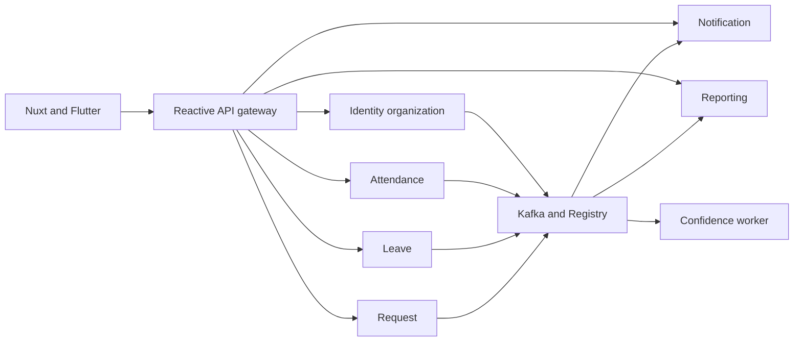

# HRFlow system architecture

## Final decision and document boundary

The user explicitly accepted the latest seven-service design on 2026-10-23 and subsequently deferred AWS/Kubernetes as a future improvement. This supersedes the modular-monolith, React and self-host-only choices in ADR 006. [ADR 008](adr/008-FINAL-SERVICE-AND-CLOUD-DESIGN.md) records that correction. On 2026-10-26, [ADR 010](adr/010-DUAL-JWT-VALIDATION.md) replaced only its gateway-header trust clause with independent access-token validation at the gateway and every Java service; [ADR 011](adr/011-SPRING-RESOURCE-SERVER-JWT.md) then selected Spring Security OAuth2 Resource Server instead of custom JWT filters for those gates.

The complete latest design is preserved in the parts below, split only to satisfy the existing 500-line format contract. No system design content is discarded. Names, performance figures and code in these parts are proposed targets until verified against source. The design's inline numbered decision list is a topic summary, not the formal ADR file numbering.

- [Final design part 01](reference/INCOMING-ARCHITECTURE-V2-01.md).
- [Final design part 02](reference/INCOMING-ARCHITECTURE-V2-02.md).
- [Final design part 03](reference/INCOMING-ARCHITECTURE-V2-03.md).
- [Final design part 04](reference/INCOMING-ARCHITECTURE-V2-04.md).

## Chosen architecture

Seven Java services: API gateway, identity-org, attendance, leave, request, notification and reporting. A separate Python confidence worker is included in the final design. Java 21, aligned Spring Boot 4.1.x, reactive Spring Cloud Gateway, explicit Spring JDBC, PostgreSQL schema ownership, Kafka KRaft and Avro/Schema Registry are the target. Nuxt/Vue/TypeScript is retained; Flutter is the mobile client.

Docker Compose is the twelve-week deployment target on one confirmed computer. The latest user reply deferred AWS/Kubernetes as a future improvement; the full final design retains that production topology and Terraform work as future design intent. Do not delete the cloud design or count it as delivered locally. No AWS resource or billable service is authorized by this documentation pass.

Text version:

- Clients call the gateway. Six business services own their data and communicate asynchronously through Kafka.
- A command writes business state, audit and owner-local outbox atomically; consumers commit effect plus inbox before offset acknowledgment.
- Nuxt, Flutter and the confidence worker are distinct clients/workloads; no monolith or React migration is planned.

## Explicit unresolved constraints

Every protected request has two authentication gates: the gateway validates the bearer access JWT, forwards the original bearer credential, and the destination Java service validates it again before constructing its principal or entering business logic. Both gates use Spring Security OAuth2 Resource Server JWT support, not application-owned JWT authentication filters. Caller-supplied identity headers are stripped and never become tenant, employee or role authority. Q04 requires tenant provenance from the service-validated token and Q05 still requires method/resource authorization. Until both gates, key rotation, network isolation, direct-service, forged-header and wrong-tenant cases are tested, security is not accepted. The [review](roadmap/ARCHITECTURE-REVIEW-V2.md) preserves the earlier assurance gap as historical analysis; ADR 010 controls the boundary and ADR 011 controls its implementation mechanism.

AWS cannot be declared free without confirmed account credits and an approved regional cost estimate. Region, budget and credit eligibility remain unknown. A single local host and single broker/database are not high availability; a PDB or rolling-update setting does not change that. No paid resource is created by this documentation pass.

The original 182 steps describe a different topology. Their old hour totals do not certify this design. The [capacity review](roadmap/ARCHITECTURE-REVIEW-V2.md) preserves the initial shortfall alongside the final decomposed allocation; [V2 progress](roadmap/PROGRESS-V2.md) records completed guide reconciliation and unexecuted application gates.

## Implementation evidence

Source paths include services/api-gateway, services/identity-org, services/attendance, services/leave, services/request, services/notification and services/reporting. web/package.json already selects Nuxt; ml/confidence-service contains standalone scoring/tests. Root and service poms now share Java 21/Boot 4.1.1 through the parent. The gateway and identity-org currently configure Spring Security OAuth2 Resource Server; the other five owner services remain scaffolds for this security boundary. [Service configuration](SERVICE-CONFIGURATION.md) records environment loading, private ports and deny-by-default security, but configuration presence does not prove the complete JWT/tenant acceptance matrix. No unverified business, Kubernetes or Terraform implementation is inferred from this design.

infra/docker/postgres-init.sql creates identity_org, not the final design's abbreviated identity schema. Keep identity_org as the physical schema to preserve existing initialization; identity is the conceptual owner. Proposed table names in the contract are not installed migrations.

[Contracts](REST-API-DATABASE-DESIGN.md), [decision register](roadmap/DECISION-REGISTER.md), [source-of-truth map](SOURCE-OF-TRUTH.md), and [ADR index](adr/README.md) resolve terminology and historical conflicts. ADR 010 controls the two-gate access-token boundary when older approved reference text still describes gateway-injected identity headers; ADR 011 controls the Spring Security resource-server mechanism.
