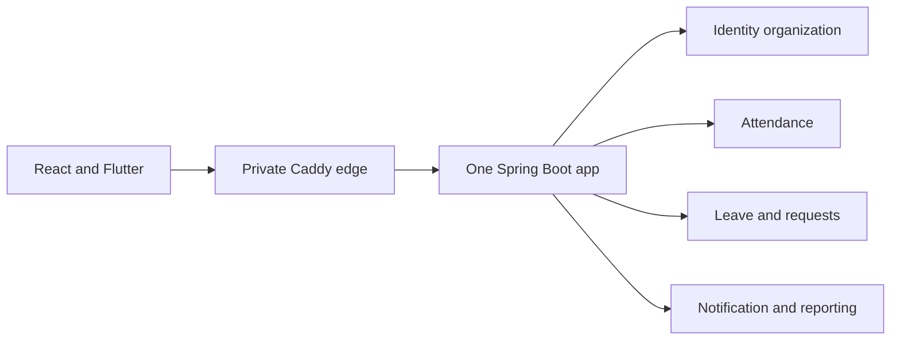
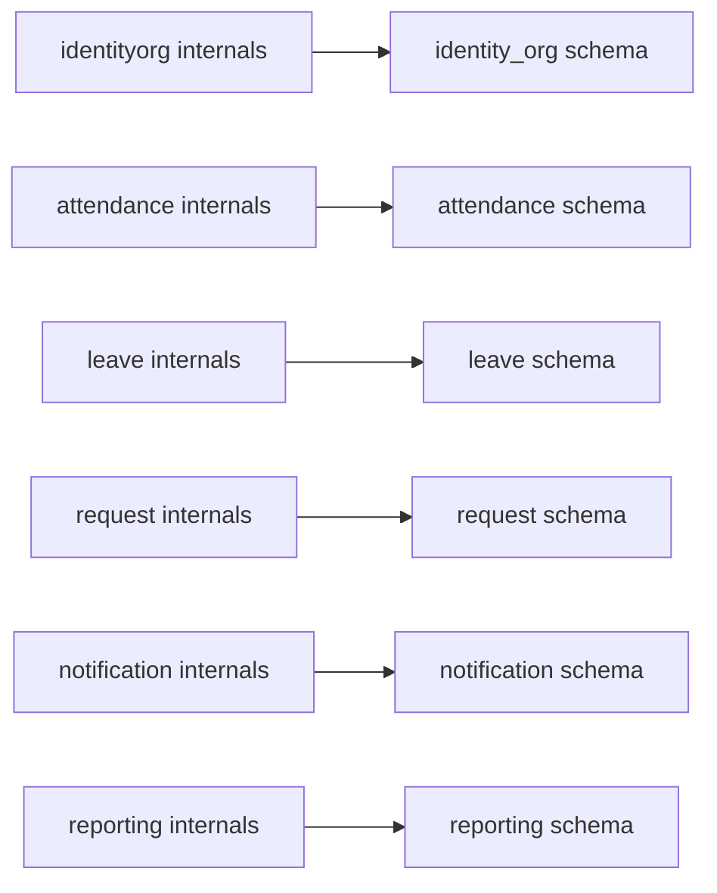
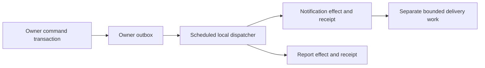
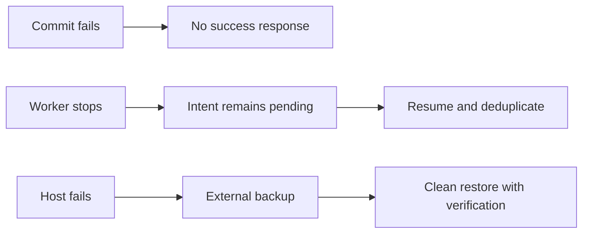

# Architecture review V2

## Evidence and decision

Outcome C remains the simplest architecture satisfying all Must features on one computer. Source re-inspection (`rg --files services libs infra .github`, `web/package.json`, `pom.xml`) still finds seven entry-point scaffolds, Nuxt, no business migrations/controllers/auth, and no deployed monolith. No evidence justifies adding deployables. User confirmed no change to position/hours/host readiness: W01-S01, 24 h each, host not ready.

Incoming uncommitted docs were preserved. `docs/Architecture.md` had 1,400 lines and contradicted ADR 006 with Kafka, Nuxt, AWS/Kubernetes and header-trusting services. The existing linter returned 223 errors, all in that file. The incoming text is archived in bounded reference parts; the accepted canonical structure is retained and clarified. `docs/SOURCE-OF-TRUTH.md` remains the navigation authority, with corrected current decisions.

## Capacity recomputation before decomposition

This table counts each step's upper stated duration once for its owner and twice for joint work. It is an estimate from text, not measured junior velocity. Normal capacity is 16.8 h each; Weeks 4/8 are 14.28. Reading/recovery consumed the remaining capacity in V1. Post-decomposition ledger is updated in phase 4 without expanding these limits.

| Week | A step h | B step h | A capacity h | B capacity h | Status |
| --- | --- | --- | --- | --- | --- |
| 01 | 10 | 7 | 16.8 | 16.8 | **CONDITIONAL PASS** estimates only |
| 02 | 12 | 7 | 16.8 | 16.8 | **CONDITIONAL PASS** estimates only |
| 03 | 10 | 7 | 16.8 | 16.8 | **CONDITIONAL PASS** estimates only |
| 04 | 7.5 | 5.25 | 14.28 | 14.28 | **CONDITIONAL PASS** estimates only |
| 05 | 10 | 7 | 16.8 | 16.8 | **CONDITIONAL PASS** estimates only |
| 06 | 10 | 7 | 16.8 | 16.8 | **CONDITIONAL PASS** estimates only |
| 07 | 10 | 7 | 16.8 | 16.8 | **CONDITIONAL PASS** estimates only |
| 08 | 7.5 | 5.25 | 14.28 | 14.28 | **CONDITIONAL PASS** estimates only |
| 09 | 10 | 7 | 16.8 | 16.8 | **CONDITIONAL PASS** estimates only |
| 10 | 10 | 7 | 16.8 | 16.8 | **CONDITIONAL PASS** estimates only |
| 11 | 10 | 7 | 16.8 | 16.8 | **CONDITIONAL PASS** estimates only |
| 12 | 10 | 7 | 16.8 | 16.8 | **CONDITIONAL PASS** estimates only |

## Every ADR reviewed

| ADR | Verdict | Evidence and simplicity | Cost and junior adoption |
| --- | --- | --- | --- |
| 001 | **Keep** superseded | Entry-point services do not justify restoring Kafka topology | No runtime cost while historical |
| 002 | **Adjust** | Tenant columns/grants alone insufficient; Q04 asks explicit RLS choice | Adopt tested personal-data RLS within Week-3 time replacing Builder refactor |
| 003 | **Adjust** | Original text still says broker offsets/Avro; ADR 006 selects local receipts | Keep atomic outbox/inbox, remove runtime Kafka assumptions |
| 004 | **Keep** proposed policy | Preserve evidence and review conflicts; HR sign-off remains needed | No new component; tests define manual/cancel semantics |
| 005 | **Keep** superseded | User requires React/self-host, not Nuxt/Kubernetes exploration | No cloud/cluster budget |
| 006 | **Keep** architecture | Source mostly unbuilt; one runtime preserves domain packages | No extra service; current hours unchanged |
| 007 | **Adjust** new refinement | RLS, module fitness and problem-details consistency are required quality practices | Free tools, no new runtime; no certification claim |

[ADR 007](../adr/007-QUALITY-AND-TENANT-DEFENSE.md) supersedes only conflicting tenant/event ownership clauses, not outcome C or business scope. Index statuses must match the actual record; Proposed domain policy is not silently labeled Accepted.

## Boundaries

Text version:

- One JVM holds six domain packages; Caddy handles ingress, not business authorization.
- Each package exposes a small api surface and keeps repositories/internal implementations private.

## Data ownership

Text version:

- No cross-domain business-table join or FK; foreign employees are local references or public port values.
- Each writer keeps audit and outbox with its transaction; receipts live with their handler effects.

## Event flow

Text version:

- Atomic publication intent survives worker failure; no Kafka acknowledgment exists in this runtime.
- Replay checks handler receipt and aggregate revision; external side effects can remain uncertain after timeout.

## Failure modes

Text version:

- Retryable commands preserve keys after uncertain commits; workers retain incomplete intents.
- One host has no high availability; a dump is not a backup success until restore evidence exists.

## Q10 dependency rules

- Packages follow `com.hrflow.app.DOMAIN.api` and `internal`; names are proposed until inspection creates them.
- Controllers call own application services; domain code imports no controller, Spring MVC or persistence implementation.
- Foreign modules may import only public api contracts, never internal services, JPA entities or repositories.
- Public contract dependencies are acyclic; shared code is only value types/clock/event metadata and never imports domains.
- A composition-root dispatcher wires ports but never reads another module's business repository. Test classes may use explicit test fixtures only.
- ArchUnit imports actual compiled packages and fails on a deliberately introduced forbidden dependency; also detect cycles. Empty package imports must fail, not produce a vacuous green test.

## Impact matrix

| Files | Affected old range | Reason | Action |
| --- | --- | --- | --- |
| Architecture.md, canonical API, source map, ADR index | W01–W12 | Topology/error/schema contradictions | Retain C; canonical corrections and archival links |
| Week 1 guides and gates | W01-S04–S15 | Contract/error/CI quality missing | Atomic golden-slice foundation and quality slots |
| Week 2 guides and gates | W02-S01–S17 | Auth combined tasks and absent throttling | Twenty auth steps plus secure host gate |
| Week 3 guides and gates | W03-S01–S15 | RLS/fitness undefined | Replace optional Builder refactor with tenant defense |
| Weeks 4–12 guides and gates | All existing steps | Missing undo/habit and broad coupled changes | Map IDs and preserve goals; local event semantics |
| Shared standards/checklists/primers/runbooks | All weekly references | Quality enforcement not traceable | Add shared assets and one golden slice |

No application source is changed. Later phase records list exact affected file paths and ID mappings. Every change is tied to one of the measured defects or Q01–Q14, not a new component menu.
