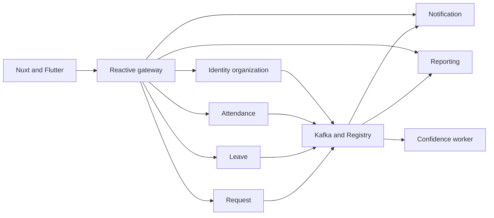
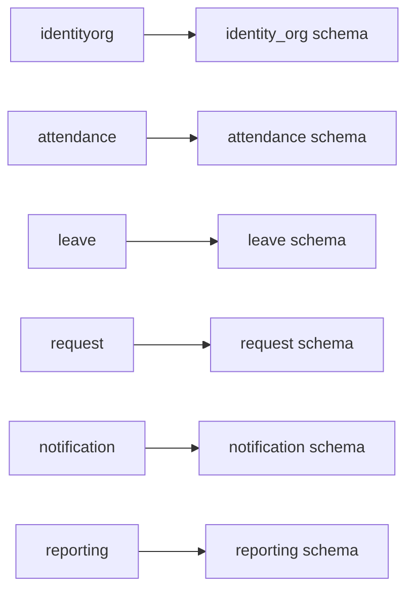
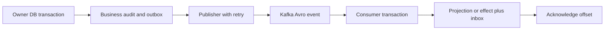
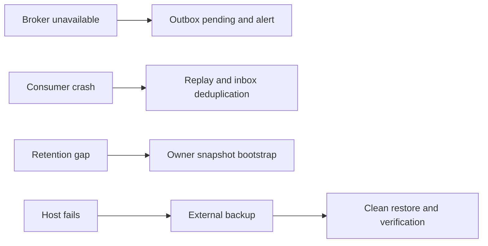

# Architecture review V2

## Chosen outcome and requirement

Accept the latest user-approved seven-service system design, not the earlier modular-monolith simplification. The user first required AWS/Kubernetes within twelve weeks, then said “skip it for now, it will be future improvment” when asked about region/budget. The latest instruction defers cloud execution; the approved production design is preserved. Twelve-week deployment is local Compose, with no cloud spending assumed. [ADR 008](../adr/008-FINAL-SERVICE-AND-CLOUD-DESIGN.md) records this supersession.

The requirement satisfied is service-owned HR domains with Kafka event integration, JDBC, Nuxt and Flutter. It is a final design choice, not proof that the scope fits 24 hours each. User confirmed W01-S01 unstarted, unchanged A/B hours and host not ready. No application changes were made in this pass.

## Re-inspection evidence

- services/identity-org/src/main/java/com/hrflow/identityorg/IdentityOrgApplication.java and six peer Application files are startup scaffolds; no business controllers/entities/migrations/security are inferred. `rg --files services libs infra` is the inventory command.
- pom.xml selects Java 21 and Boot 4.1.1; service poms still use 4.0.8. services/api-gateway/pom.xml currently uses MVC gateway dependencies, conflicting with the approved reactive target. Business poms contain JPA dependencies; the accepted design calls for JDBC.
- web/package.json and web/package-lock.json select Nuxt/Vue; retaining them avoids the superseded React migration. libs/hrflow-contracts/events/attendance-checked-in.v1.avsc is an actual Avro file; contracts/openapi.yaml is still proposed.
- infra/docker/postgres-init.sql creates identity_org plus the five other owner schemas. infra/docker/docker-compose.yaml has PostgreSQL/Kafka/Registry scaffolding, but the SQL mount/listener paths require inspection and correction before running. It is not a deployed service topology.
- ml/confidence-service contains standalone confidence code/tests; Kafka worker integration remains future implementation. Existing Python tests passing do not prove event integration.
- Safe recorded outputs: `mvn -o validate` passed ten reactor projects; `mvn -o test` failed resolving uncached Avro/Jackson before Java compilation; Nuxt build passed; Python pytest passed five tests with one warning; Docker daemon was unavailable. These results are baseline evidence, not application gates.

## Historical pre-decomposition demand estimate

Single source inputs are in [dashboard](YOU-ARE-HERE.md): 24 h each, fraction 0.70, light factor 0.85. Normal planned capacity is 16.8 each, Weeks 4/8 14.28 each. Twelve-week capacity is 196.56 each, 393.12 combined. The old 182-step upper-duration ledger totals A=117 and B=80.5 hours; reading adds 24 each. It described a different architecture and omitted much of the quality bar.

The following is a planning-demand estimate, not scheduled hours or measured junior velocity. Incremental work is explicitly additional to the old core: A=160 h for service/broker/JDBC/Avro integration and local operations; A=48 h for missing quality practices; B=24 h contract/device integration and 12 h quality checks. Each week's delta is recorded so it can be replaced with decomposed estimates. Nothing is compressed to a 30-minute label merely to claim feasibility. The 30 percent reserve stays unallocated.

| Week | Old step h A/B | Extra h A/B | Demand incl reading A/B | 70% limit A/B | Verdict |
| --- | --- | --- | --- | --- | --- |
| 01 | 10/7 | 21/3 | 33/12 | 16.8/16.8 | **FAIL** A demand exceeds limit |
| 02 | 12/7 | 24/3 | 38/12 | 16.8/16.8 | **FAIL** A demand exceeds limit |
| 03 | 10/7 | 20/3 | 32/12 | 16.8/16.8 | **FAIL** A demand exceeds limit |
| 04 | 7.5/5.25 | 11/3 | 20.5/10.25 | 14.28/14.28 | **FAIL** A demand exceeds limit |
| 05 | 10/7 | 26/3 | 38/12 | 16.8/16.8 | **FAIL** A demand exceeds limit |
| 06 | 10/7 | 11/3 | 23/12 | 16.8/16.8 | **FAIL** A demand exceeds limit |
| 07 | 10/7 | 10/3 | 22/12 | 16.8/16.8 | **FAIL** A demand exceeds limit |
| 08 | 7.5/5.25 | 10/3 | 19.5/10.25 | 14.28/14.28 | **FAIL** A demand exceeds limit |
| 09 | 10/7 | 23/3 | 35/12 | 16.8/16.8 | **FAIL** A demand exceeds limit |
| 10 | 10/7 | 27/3 | 39/12 | 16.8/16.8 | **FAIL** A demand exceeds limit |
| 11 | 10/7 | 15/3 | 27/12 | 16.8/16.8 | **FAIL** A demand exceeds limit |
| 12 | 10/7 | 10/3 | 22/12 | 16.8/16.8 | **FAIL** A demand exceeds limit |

Total demand is A=349, B=140.5, combined 489.5 contributor-hours. This exceeds combined planned capacity by 96.38 h and A's capacity by 152.44 h. B's unused budget cannot be treated as backend expertise without training/pairing costs. This estimate does not include AWS/Kubernetes execution, which is now deferred. The initial full-scope estimate was **FAIL**; it is retained as a risk signal, not the final atomic ledger. The final schedule below supersedes it for planned hours.

Delta estimate basis: Weeks 1–3 align seven builds, reactive gateway/JDBC, Avro compatibility and tenant/security fixtures; Weeks 4–8 add service-owned projections, Kafka outbox/inbox replay and cross-client/event tests; Week 9 adds reporting/confidence integration and observability; Weeks 10–12 add multi-workload deploy/recovery, replay/security hardening and release rehearsal. These are planning allowances, not invented command timings. Phase 4 atomic ledgers must refine or disprove them with evidence.

Optional polish/push/extra charts/pattern refactors move to Stretch first. Security, tenant tests, event correctness and backup restore stay mandatory. If atomic estimates still exceed capacity after optional cuts, record unallocated Must work and ask for a scope/hours/deadline decision; do not silently change the architecture. Existing week READMEs retain their old budgets until upgraded and cannot certify the full new scope.

## ADR review

| ADR | Verdict | Evidence and simplest permitted option | Cost and beginner adoption |
| --- | --- | --- | --- |
| 001 | **Adjust** | Restore service ownership/Kafka per latest Architecture; clarify outbox/inbox | More processes and failure paths; template plus real integration tests required |
| 002 | **Adjust** | Scoped JDBC, tenant composite keys/indexes plus personal-data RLS | No paid tool; non-owner roles/pool tests consume explicit Week-3 quality time |
| 003 | **Adjust** | Kafka/Avro restored; owner transaction and effect/receipt before offset | Registry and broker recovery are real work, not local-worker substitutes |
| 004 | **Keep** proposed | Manual evidence precedence/review preserved; HR sign-off unknown | No component; policy test fixtures before coding |
| 005 | **Adjust** | Nuxt retained; cloud topology future, Compose now | Existing npm lockfile reused; cloud has no approved spend |
| 006 | **Replace** | User explicitly accepts latest seven-service design | Superseded by 008; old feasibility result invalid |
| 007 | **Adjust** | Retain RLS/problem/audit/fitness; replace local dispatch semantics | Free quality tools, extra engineering time recorded above |
| 008 | **Keep** | Records latest accepted architecture and cloud deferral | No certification or delivery guarantee; host/resources still unknown |

[ADR index](../adr/README.md) is authoritative for supersession; original Proposed policy is not silently promoted. All code/tool versions still require compatibility verification, particularly Boot/Cloud/Avro. No class/table/route is called implemented merely because a design names it.

## Service boundaries

Text version:

- Gateway routes user HTTP; each business service owns its commands, queries and role/resource checks.
- Services use events and local read models, not business-service HTTP or another service's Java internals.

## Data ownership

Text version:

- One PostgreSQL instance, schema/runtime role per owner; no cross-schema business query or FK.
- Foreign employee facts are local projections. Outbox/audit stay with writer; inbox stays with consumer effect.

## Event flow

Text version:

- Mark sent after broker acknowledgment; a crash between acknowledgment and marking can duplicate publication.
- Commit effect and receipt before offset; inbox and aggregate revision suppress duplicates/stale snapshots. External provider delivery has its own bounded retry state.

## Failure modes

Text version:

- Kafka recovery does not replace database/attachment backup, and replay must detect retention gaps rather than silently skip history.
- A single host has no high availability; restore is acceptance evidence, not the existence of a dump file.

## Q10 dependency rules

- Use existing roots com.hrflow.identityorg, attendance, leave, request, notification, reporting and gateway; inspect before choosing a class name. Proposed subpackages are api, application, domain and infrastructure, matching the final design's dependency direction rather than a new monolith root.
- Domain imports no Spring/JDBC/Kafka/web classes. API calls its own application layer. Infrastructure implements domain/application ports; domain never imports infrastructure.
- No service imports another service's implementation packages or depends on its Maven artifact. Shared contracts/event starter contain no owner business logic or repositories.
- Service JDBC code names only owner schema. Dynamic SQL identifiers are allowlisted; ArchUnit cannot prove SQL tenant predicates, so repository/RLS tests remain mandatory.
- Automated architecture tests import nonempty actual packages, assert cycles/dependency rules, and fail on an intentional forbidden import fixture. Empty tests cannot satisfy Q10.
- Build module dependencies are checked as well as packages, so an empty service or shared library cannot conceal a reverse dependency. API gateway owns no domain persistence.

## Security boundary requiring proof

Keep final gateway header-trust decision. Gateway removes all incoming identity headers before adding fields derived solely from a verified JWT. Business ports are unpublished/private, role/resource checks are method-level, and database tenant context is transaction-local. Prove forged headers, invalid tokens, wrong roles, foreign tenant IDs, direct business-service access and monitoring-only access. A container network alone is not cryptographic identity; a compromised trusted network peer remains a documented limitation. Q04/Q05 are conditional until tests prove the chosen boundary, and any stronger per-service validation change needs a superseding decision.

## Impact matrix

| Roadmap files | Old range | Measurable conflict or gap | Required correction |
| --- | --- | --- | --- |
| ROADMAP, DECISION-REGISTER, MILESTONE-MAP | All weeks | Monolith/React/no broker | Final services/Nuxt/Kafka; cloud deferred |
| Preparation baseline/migration and repo audit | W01-S01–S06 | Old architecture cost assumed | Preserve source roots and recompute service work |
| W01 README, BUILD-GUIDE parts, VERIFY, TROUBLESHOOTING | W01-S01–S15 | hrflow-app and React migration | Seven-service compatibility spike, Nuxt, broker baseline |
| W02 README, BUILD-GUIDE parts, VERIFY, TROUBLESHOOTING | W02-S01–S17 | Auth combined; one-app host | Atomic auth and private multi-service host/restore |
| W03 README, BUILD-GUIDE parts, VERIFY, TROUBLESHOOTING | W03-S01–S15 | JPA/module assumptions | JDBC/RLS/golden slice/service fitness |
| W04 README, BUILD-GUIDE parts, VERIFY, TROUBLESHOOTING | W04-S01–S15 | In-process dependencies | Attendance owner projections and invariants |
| W05 README, BUILD-GUIDE parts, VERIFY, TROUBLESHOOTING | W05-S01–S15 | Local worker semantics | Kafka/Avro publisher/receipt/offset/replay |
| W06 README, BUILD-GUIDE parts, VERIFY, TROUBLESHOOTING | W06-S01–S15 | Monolith leave integration | Exact balances plus event conflict handling |
| W07 README, BUILD-GUIDE parts, VERIFY, TROUBLESHOOTING | W07-S01–S15 | Requests/files owner boundaries | Request service, actor/tenant tests, private files |
| W08 README, BUILD-GUIDE parts, VERIFY, TROUBLESHOOTING | W08-S01–S15 | React and late client join | Nuxt/Flutter compatibility and event convergence |
| W09 README, BUILD-GUIDE parts, VERIFY, TROUBLESHOOTING | W09-S01–S15 | Local reporting/no broker metrics | Consumer lag/bootstrap/export/telemetry |
| W10 README, BUILD-GUIDE parts, VERIFY, TROUBLESHOOTING, HOST-RUNBOOK | W10-S01–S15 | One-app deployment/restore | Multi-service recovery, Kafka offsets and Registry |
| W11–12 READMEs, BUILD-GUIDEs, gates and diagnostics | W11-S01–W12-S15 | Missing all-Q release evidence | Security/replay/load/restore and honest limitations |
| Shared standards, tests, commands, golden slice, runbooks | All references | C-specific paths/events/client | Owner roots, Kafka tests, Nuxt; no invented existing code |
| Global checklist, pattern path, definition of done, start/dashboard | All IDs | New steps/gates untraced | Map every old ID; preserve tags; no prechecked tasks |

The exact per-file map after splitting belongs in STEP-ID-MAP.md. This was the initial affected-file inventory; all current weekly guides are now reconciled. The final validation report records the remaining runtime/hosting limits.

## Final bottom-up schedule and reconciliation

The previous 489.5-hour figure added coarse service/quality allowances to broad V1 tasks; it was not measured velocity. Decomposition now assigns every narrow feature delta, reused golden-slice check, five additional service context alignments, explicit browser/profile/CSRF work, Kafka recovery and six runbooks to real step IDs. B owns repeatable fixtures/client/ops work, with A review/mentoring explicitly charged; mandatory security/restore is not cut. Optional pattern refactors, richer UI/report variants, push/SSE and cloud execution do not consume the minimum path.

| Week | A h | B h | Limit each | Evidence |
| --- | --- | --- | --- | --- |
| 01 | 14 | 14.25 | 16.8 | [38 steps](01-FOUNDATION/README.md) |
| 02 | 14.25 | 11 | 16.8 | [35 steps](02-IDENTITY-AND-HOST/README.md) |
| 03 | 14.25 | 14.25 | 16.8 | [41 steps](03-ORGANIZATION-AND-ADMIN/README.md) |
| 04 | 9.5 | 12.25 | 14.28 | [36 steps](04-ATTENDANCE-CORE/README.md) |
| 05 | 10 | 14.25 | 16.8 | [36 steps](05-OUTBOX-AND-NOTIFICATIONS/README.md) |
| 06 | 10.25 | 14 | 16.8 | [36 steps](06-LEAVE-WORKFLOW/README.md) |
| 07 | 13.5 | 14.25 | 16.8 | [42 steps](07-REQUESTS-AND-APPROVALS/README.md) |
| 08 | 7.75 | 12.25 | 14.28 | [33 steps](08-WEB-AND-MOBILE-INTEGRATION/README.md) |
| 09 | 13.25 | 14 | 16.8 | [41 steps](09-REPORTING-AUDIT-OBSERVABILITY/README.md) |
| 10 | 13.5 | 14 | 16.8 | [42 steps](10-OPERATIONS-AND-RESTORE/README.md) |
| 11 | 9.25 | 14 | 16.8 | [34 steps](11-HARDENING-AND-PILOT/README.md) |
| 12 | 9.25 | 14 | 16.8 | [34 steps](12-RELEASE-AND-DEMONSTRATION/README.md) |

Final planned total is 301.25 h, A=138.75/B=162.5.5, leaving 91.87 h below the 70-percent planning ceiling. This is an itemized estimate, not evidence that work became faster or the initial risk disappeared. Shared infrastructure is built once then tested per feature; the earlier blanket overhead is not charged a second time. Basic source/test/tool familiarity and narrow MVP screens are explicit assumptions. If Week-1 actuals invalidate the durations, keep critical gates and report a concrete scope/date conflict instead of lowering observed timings.

[Roadmap](ROADMAP.md) and weekly README totals are derived outputs from the single dashboard capacity input. [Quality coverage](QUALITY-COVERAGE.md) links every Q-item and [ID map](STEP-ID-MAP.md) preserves all old progress. The user accepted the final design; no further architecture approval is needed for this documented local finish line. Runtime evidence remains **NOT RUN**.
