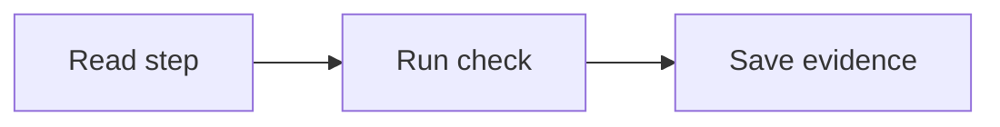

# Format selftest

## Text and navigation

A single-line paragraph contains **PASS**, **CONDITIONAL PASS**, **FAIL**, and **NOT RUN**. Literal tokens are `TENANT_ID`, `$`, `#word`, `[[`, and `{{`. [Start here](START-HERE.md) is a relative Markdown link; [Caddy docs](https://caddyserver.com/docs/) is an external HTTPS link.

> **Note:** Read this in all three target viewers; fallback text is authoritative.

> **Warning:** A visual pass is separate from a syntax pass.

> **Decision:** Portable text remains available without Mermaid support.

> **Evidence:** No manual viewer result has been invented.

> **Pitfall:** Do not let import change the meaning of a checkbox.

### Lists and matrix

- Parent item.
    - Nested item.

1. First numbered item.
1. Second numbered item.

- [ ] Verify this checkbox remains unchecked.

```bash
printf 'selftest\n'
```

| Construct | Expectation |
| --- | --- |
| Table | Two readable columns |

### Fenced examples

```java
record Tenant(String id) {}
```

```sql
SELECT 1;
```

```yaml
status: ready
```

```json
{"status":"ready"}
```

```ts
const ready: boolean = true;
```

```dart
const ready = true;
```

```xml
<status>ready</status>
```

```properties
status=ready
```

```text
Ready means observable evidence exists.
```



Text version:

- Read one step, run its check, save evidence.
- If Mermaid is unsupported, these bullets convey the complete flow.

## Three-minute manual check

- [ ] IntelliJ: preview headings, task, table, code, link and diagram or text fallback for one minute.
- [ ] Obsidian: repeat using docs vault and relative links for one minute.
- [ ] Notion: ZIP-import the folder and repeat for one minute.

Status: **NOT RUN**. Record application version and any import issue before claiming visual compatibility.
